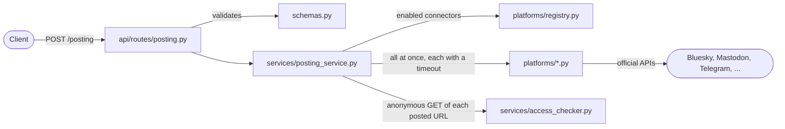

# Automated Multi-Platform Posting

[](https://github.com/elwizard33/automated-posting/actions/workflows/ci.yml)

A FastAPI service that takes one short message with a single link and publishes it to several
platforms through their official APIs. Each platform is handled on its own, so one failing does
not stop the others.

This is my submission for the Python practical test (Automated Multi-Platform Posting System).

## Contents

- [Quick start](#quick-start)
- [API](#api)
- [Platform research](#platform-research)
- [Configuration](#configuration)
- [How it works](#how-it-works)
- [Design decisions](#design-decisions)
- [Live run](#live-run)
- [Tests](#tests)
- [What I would add for production](#what-i-would-add-for-production)

## Quick start

Requires Python 3.11 or newer.

```bash
git clone https://github.com/elwizard33/automated-posting.git
cd automated-posting

python -m venv .venv
source .venv/bin/activate          # Windows: .venv\Scripts\activate
pip install -r requirements.txt

cp .env.example .env               # then fill in the platforms you want
uvicorn app.main:app --host 0.0.0.0 --port 4000
```

With [uv](https://docs.astral.sh/uv/) instead of pip:

```bash
uv sync
uv run uvicorn app.main:app --host 0.0.0.0 --port 4000
```

Then open:

- http://localhost:4000/docs for the interactive API docs
- http://localhost:4000/ for a small page that calls the API and shows the results

The server starts without any credentials. Platforms that are not configured are reported as
failed with the names of the settings they need, so you can try the API before creating accounts.

## API

### `POST /posting`

```bash
curl -X POST http://localhost:4000/posting \
  -H "Content-Type: application/json" \
  -d '{"message": "Check out our latest business platform and grow your online visibility. https://example.com"}'
```

Validation rules:

| Rule | Error message |
|---|---|
| Message is required and not blank | `Message must not be empty` |
| At most 200 characters, counted after trimming whitespace | `Message must not exceed 200 characters (got 201)` |
| Exactly one link | `Message must contain exactly one link (found 2)` |
| The link uses `http://` or `https://` | `Link must start with http:// or https://` |
| The link is a well-formed URL on a public domain | `Link is not a valid URL`, `Link must point to a public domain name`, `Link must not contain credentials` |
| No other fields in the body | `Unknown field` |

The client cannot choose platforms. Which ones run is decided by server configuration.

Response, `200` whenever the input is valid:

```json
{
  "success": true,
  "summary": { "total": 8, "succeeded": 7, "failed": 1 },
  "results": [
    {
      "platform": "Bluesky",
      "status": "success",
      "posted_url": "https://bsky.app/profile/example.bsky.social/post/3kabc",
      "public_access": true,
      "date": "2026-11-18",
      "time": "14:03:22",
      "error": null
    },
    {
      "platform": "Mastodon",
      "status": "failed",
      "posted_url": null,
      "public_access": false,
      "date": null,
      "time": null,
      "error": "HTTP 401: The access token is invalid"
    }
  ]
}
```

- `success` is true when at least one platform published the message.
- `date` and `time` are UTC, taken when that platform confirmed the post.
- `public_access` says whether the posted URL opens without logging in. See
  [Design decisions](#design-decisions) for how it is checked.
- `summary` is an addition to the format in the brief. The fields in `results` are exactly the
  ones the brief lists.

Validation errors return `422` in one shape, including malformed JSON and missing fields:

```json
{
  "success": false,
  "error": {
    "code": "validation_error",
    "message": "Request validation failed",
    "details": [
      { "field": "message", "message": "Message must contain exactly one link (found 2)" }
    ]
  }
}
```

### Other routes

| Route | Purpose |
|---|---|
| `GET /connectors` | Every connector with its auth type, whether it is enabled and configured, and which settings are missing. Never returns credential values. |
| `GET /health` | Liveness check. |
| `GET /` | Demo page. |
| `GET /docs` | OpenAPI docs with request and error examples. |

## Platform research

I looked for platforms where a new account can get API access the same day, with no app review
and no paid plan, and where a post gets a URL I can return.

### Live platforms (enabled by default)

| Platform | What gets created | Auth | Posted URL public | API docs |
|---|---|---|---|---|
| Bluesky | A post, with the link marked as a clickable facet | Handle and app password, exchanged for a session token | Yes | [createRecord](https://docs.bsky.app/docs/api/com-atproto-repo-create-record) |
| Mastodon | A public status | Bearer token | Yes | [statuses](https://docs.joinmastodon.org/methods/statuses/#create) |
| Telegram | A message in a public channel, sent by a bot | Bot token in the URL | Yes | [sendMessage](https://core.telegram.org/bots/api#sendmessage) |
| Telegraph | A public page | Access token in the body | Yes | [createPage](https://telegra.ph/api#createPage) |
| GitHub Gist | A public gist with the message as `post.md` | Bearer token | Yes | [create a gist](https://docs.github.com/en/rest/gists/gists#create-a-gist) |
| DEV Community | A published article | `api-key` header | Yes | [createArticle](https://developers.forem.com/api/v1#tag/articles/operation/createArticle) |
| Hugging Face | A community discussion on a repository I own | Bearer token | Yes | [discussions](https://huggingface.co/docs/huggingface_hub/guides/community) |
| Discord | A channel message through a webhook | The webhook URL | No, members only | [execute webhook](https://discord.com/developers/docs/resources/webhook#execute-webhook) |

Hugging Face is here because the brief asks for "supported LLM platforms" as well as websites and
portals. Discord is the one platform where `public_access` is correctly `false`.

Things I learned from the docs that shaped the code:

- Bluesky does not auto-link URLs. The post needs a facet with the link's position in UTF-8
  bytes, not characters, or the link shows as plain text.
- Telegraph answers `200` even when it rejects a request, with `"ok": false` in the body.
- Discord's webhook response has no server id, which the message URL needs. The connector reads
  it from the webhook lookup before posting.
- LinkedIn returns the new post's id in the `x-restli-id` header with an empty body, and its
  post text format needs characters such as `(`, `#` and `_` escaped.
- Telegraph and DEV need a title, so one is derived from the text around the link.

### Implemented but off by default

These connectors are written and unit-tested against the documented requests and responses. I
have not run them against the real APIs, because access needs a paid plan or an approved app.
Add the key to `PLATFORMS_ENABLED` and set the credentials to use one.

| Platform | Why it is off | API docs |
|---|---|---|
| X | Creating posts needs a paid API plan | [create post](https://docs.x.com/x-api/posts/create-post) |
| LinkedIn | Posting needs an app approved for the Share or Community Management product | [Posts API](https://learn.microsoft.com/en-us/linkedin/marketing/community-management/shares/posts-api) |
| Facebook Page | Needs a Meta app and a Page access token | [Page posts](https://developers.facebook.com/docs/pages-api/posts) |

### Considered and rejected

| Platform | Reason |
|---|---|
| Reddit | API access needs approval, and most communities ban this kind of promotional cross-post. |
| Medium | The publishing API no longer issues tokens to new integrations. |
| Instagram | The API cannot publish text-only posts. It needs media and a business account. |

## Configuration

All settings come from environment variables or a `.env` file. `.env.example` lists every one.

| Platform | Settings | Where to get them |
|---|---|---|
| Bluesky | `BLUESKY_HANDLE`, `BLUESKY_APP_PASSWORD` | Settings > Privacy and security > App passwords |
| Mastodon | `MASTODON_BASE_URL`, `MASTODON_ACCESS_TOKEN` | Preferences > Development > New application, scope `write:statuses` |
| Telegram | `TELEGRAM_BOT_TOKEN`, `TELEGRAM_CHANNEL` | Create a bot with @BotFather, create a public channel, add the bot as an admin |
| Telegraph | `TELEGRAPH_ACCESS_TOKEN` | `curl "https://api.telegra.ph/createAccount?short_name=posting&author_name=Your+Name"` |
| GitHub Gist | `GITHUB_GIST_TOKEN` | Settings > Developer settings > Fine-grained tokens, account permission Gists: read and write |
| DEV Community | `DEVTO_API_KEY` | Settings > Extensions > DEV Community API Keys |
| Hugging Face | `HUGGINGFACE_TOKEN`, `HUGGINGFACE_REPO_ID` | Settings > Access Tokens (write), and a public repository you own |
| Discord | `DISCORD_WEBHOOK_URL` | Server Settings > Integrations > Webhooks |

General settings:

| Setting | Default | Meaning |
|---|---|---|
| `PLATFORMS_ENABLED` | the eight live platforms | Comma-separated connector keys. An unknown key stops the server at startup with a clear message. |
| `PLATFORM_TIMEOUT_SECONDS` | `15` | Time allowed for one platform. |
| `ACCESS_CHECK_TIMEOUT_SECONDS` | `5` | Time allowed for the public access check. |
| `LOG_FORMAT` | `console` | `console` or `json`. |

## How it works



```text
app/
  main.py                  app factory, startup and shutdown, request id
  config.py                settings from the environment
  schemas.py               request and response models, validation rules
  api/
    dependencies.py        providers for settings, HTTP client and service
    routes/                posting, connectors, health
  core/                    logging setup, error handlers
  platforms/
    base.py                Connector, ConnectorSpec, PlatformError
    auth.py                shared auth strategies
    registry.py            the list of connectors
    bluesky.py ...         one module per platform
  services/
    posting_service.py     runs every connector concurrently
    access_checker.py      checks a posted URL opens without login
  utils/text.py            link detection, title derivation
  static/index.html        demo page
tests/                     offline tests, HTTP mocked with respx
```

Each platform is a connector: a short declaration plus a `_publish` method.

```python
class MastodonConnector(Connector):
    spec = ConnectorSpec(
        key="mastodon",
        name="Mastodon",
        auth=BearerToken(fields=("mastodon_access_token", "mastodon_base_url")),
        docs_url="https://docs.joinmastodon.org/methods/statuses/#create",
        max_length=500,
    )
```

The auth strategy names the settings the platform needs, reports which are missing, and builds
the auth header. Connectors do not read the environment or build auth headers themselves. The
base class turns non-2xx answers and unexpected response bodies into one error type with a
short message. Adding a platform means writing one module and adding one line to the registry.

This borrows the idea of connector definitions from integration platforms, without the part
that manages user connections (OAuth flows, token storage, refresh). Credentials here are one
account per platform, read from the environment.

## Design decisions

**No retries on publish.** A request that timed out may still have gone through. Sending it
again could post the message twice, which is worse than reporting a failure.

**Failures are isolated.** Every connector runs in its own task with its own timeout. The
wrapper around it never raises, so `asyncio.gather` cannot be cancelled by one bad platform.
Platform errors, timeouts, network errors and bugs each become a `failed` result.

**`public_access` is checked, with limits.** After a successful post the service fetches the
posted URL anonymously. A 2xx answer means public. 401, 404 or 410 means not public. Anything
else, such as a bot challenge or a rate limit, says nothing about visibility, so the connector's
declared value is kept. This is a reachability check: it shows the URL opens without logging in,
not that the content is on the page. Bluesky and Telegram web pages answer 200 for any path.

**Error messages never carry secrets.** Platform error bodies are reduced to their message
field, truncated, and scrubbed of the connector's own credentials. Network errors are reported
by type only, because their text can include a URL, and Telegram's URL contains the bot token.

**Exactly one link is strict.** Anything with a scheme (`https://`, `ftp://`) or starting with
`www.` counts as a link, so `www.a.com https://b.com` is rejected as two. The one link must be
`http` or `https`. Bare words such as `example.com` or `Node.js` are not counted, because
treating every dotted word as a link would reject normal sentences.

**Unconfigured platforms fail loudly.** An enabled platform without credentials is reported as
failed with the names of the settings to set, instead of being dropped from the response.

**Dates and times are UTC**, so the response does not depend on where the server runs.

**Layout follows the brief.** `app/main.py`, `app/config.py`, `app/schemas.py`,
`app/platforms/base.py`, `app/services/posting_service.py` and `tests/test_posting.py` are where
the suggested structure puts them. I added `api/`, `core/` and `utils/` to keep each file small.

## Live run

LIVE_RUN_SECTION

## Tests

```bash
pip install -r requirements-dev.txt    # or: uv sync
pytest
```

The suite runs offline. Platform APIs are mocked with `respx`. The error bodies are the ones the
real APIs return for bad credentials, and the success bodies follow each platform's docs. It covers:

- the validation rules and their boundaries (200 and 201 characters, zero, one and two links)
- every connector: the request it sends, an auth failure, and a malformed response
- the service: one platform failing, hanging, or crashing while the others succeed
- the HTTP layer: response shape, error shape, the connector catalog, startup checks

CI runs lint (`ruff`), type checking (`mypy --strict`) and the tests on Python 3.11 to 3.14.

## What I would add for production

- Authentication and rate limiting on `POST /posting`. Right now anyone who can reach the server
  can post to the configured accounts.
- Per-user connections: an OAuth flow per platform, encrypted token storage and refresh, in
  place of one account per platform from the environment.
- An idempotency key on the request, so a client retry cannot double-post, and stored results
  so a post can be looked up later.
- A background queue with per-platform rate limits, for volume.
- Platform-specific content: the same text is posted everywhere today.
